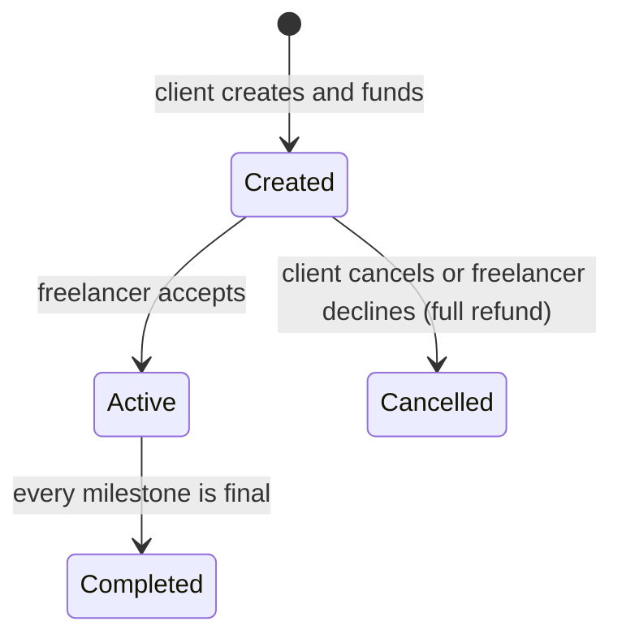
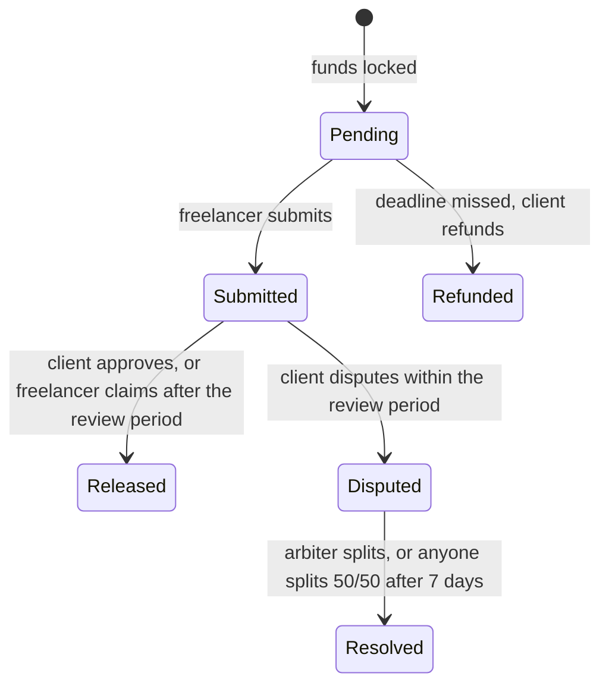

# Milestone Escrow

A smart contract that holds a client's payment and releases it to a freelancer **one milestone at a time**, so neither side has to trust the other.

A client fears paying upfront for work that never arrives. A freelancer fears delivering work that never gets paid. The money is locked before work starts, and it only moves when a milestone is approved, times out, or is settled by an arbiter both sides accepted.

> **Testnet only.** The contract is unaudited and must not hold real money.

- **Live app:** https://milestone-escrow-five.vercel.app
- **Network:** Sepolia
- **Demo video:** _add link here_
- **Example completed agreement:** _add an Etherscan transaction link here_

## Deployed contracts (Sepolia)

| Contract | Address | Source |
| --- | --- | --- |
| MilestoneEscrow | [`0xe1a42bb85a64ef48cf644a6dea72ef25e188c7d9`](https://sepolia.etherscan.io/address/0xe1a42bb85a64ef48cf644a6dea72ef25e188c7d9#code) | Verified |
| MockUSDC (test token, 6 decimals) | [`0xa3cb1354c107a1cd4352ace0b63cfc69e9d6b35b`](https://sepolia.etherscan.io/address/0xa3cb1354c107a1cd4352ace0b63cfc69e9d6b35b#code) | Verified |

Escrow deployment block: `11834415`.

## How it works

Three wallets take part in every agreement, and each can call only its own functions.

| Role | How it is set | What it can do |
| --- | --- | --- |
| Client | Whoever creates the agreement | Create and fund, cancel before acceptance, approve, dispute, refund after a missed deadline |
| Freelancer | Named by the client | Accept or decline the agreement, submit a milestone, claim after the review period |
| Arbiter | Named by the client, confirmed when the freelancer accepts | Resolve a disputed milestone |

The acceptance step protects the freelancer. Without it, a client could name a second wallet of their own as arbiter, dispute every milestone and refund themselves. If the freelancer does not want the terms, they can decline and the client is refunded in full.

### Agreement lifecycle



### Milestone lifecycle



Released, Refunded and Resolved are final: the funds for that milestone have left the contract.

Two clocks drive a milestone: its own deadline for the freelancer to submit, and the agreement's review period for the client to respond after a submission.

### Functions

| Function | Caller | Allowed when | Effect |
| --- | --- | --- | --- |
| `createAgreement` | Anyone (becomes the client) | Inputs valid, allowance covers the total | Pulls the total into escrow |
| `acceptAgreement` | Freelancer | Created | Active |
| `declineAgreement` | Freelancer | Created | Refunds the client, Cancelled |
| `cancelAgreement` | Client | Created | Refunds the client, Cancelled |
| `submitMilestone` | Freelancer | Active, milestone Pending | Submitted |
| `approveMilestone` | Client | Submitted | Pays the freelancer |
| `claimAfterTimeout` | Freelancer | Submitted, review period over | Pays the freelancer |
| `disputeMilestone` | Client | Submitted, review period not over | Disputed |
| `resolveDispute` | Arbiter | Disputed, within 7 days | Splits the amount as the arbiter decides |
| `resolveDisputeAfterTimeout` | Anyone | Disputed, more than 7 days | Splits 50/50 (an odd unit goes to the client) |
| `refundMilestone` | Client | Active, milestone Pending, deadline passed | Refunds the client |

Boundaries are exact. The client may dispute while `block.timestamp <= submittedAt + reviewPeriod`, and the freelancer may claim only when `block.timestamp > submittedAt + reviewPeriod`, so the two never overlap. The arbiter and the 50/50 timeout work the same way around `disputedAt + 7 days`.

## Design decisions

- **Checks, effects, interactions.** Every paying function sets the milestone status and updates the settled count before moving any tokens.
- **Reentrancy guard and safe transfers.** Every function that moves tokens is `nonReentrant` and uses OpenZeppelin `SafeERC20`.
- **No admin.** There is no owner, pause or rescue function. Tokens leave only through the lifecycle paths.
- **One token, fixed at deployment.** This keeps fee-on-transfer and rebasing tokens out, which would break the accounting.
- **Exact splits.** The arbiter's amount is checked against the milestone amount first, the client's share is computed by subtraction, and zero-value transfers are skipped.
- **Events carry the free text.** `note` and `reason` are emitted in events only, not stored, which keeps gas low.
- **Custom errors** instead of revert strings.
- **Balance invariant.** The escrow's token balance always equals the sum of milestone amounts that are not yet final, across agreements that are not cancelled. The tests assert this after every step of a long mixed scenario.
- **Late submission is allowed** after a deadline, until the client refunds that milestone. A refunded milestone can never be submitted.
- **Arbiter timeout.** A silent arbiter cannot lock funds forever. After 7 days anyone can split the disputed milestone 50/50.

## Run it locally

Requirements: Node 22 or later, Yarn (via Corepack) and Git.

```bash
git clone https://github.com/FritzKialo/milestone-escrow.git
cd milestone-escrow
yarn install
```

In three terminals:

```bash
yarn chain     # local blockchain
yarn deploy    # deploys MockUSDC and MilestoneEscrow
yarn start     # frontend at http://localhost:3000
```

On the local chain, the app shows a **skip chain time** bar on the agreement page. It lets you demonstrate the timeout claim, the missed-deadline refund and the arbiter timeout without waiting. The bar never appears on any other network.

To try all three roles locally, use three different wallets: for example your main browser window plus a private window in two other browsers, each of which gets its own burner wallet. Fund each from the Faucet button.

## Tests

```bash
yarn test
```

61 tests cover every path in the diagrams, every wrong-caller case, the exact boundary seconds, double-settlement attempts, two agreements side by side, events, and the balance invariant.

## Frontend

| Page | Route | What it does |
| --- | --- | --- |
| Home | `/` | Explanation, roles, live stats, test mUSDC faucet |
| Create | `/create` | Milestone form with quick splits and a two-step Approve then Create flow |
| My agreements | `/agreements` | Tabs for client, freelancer and arbiter, with "needs your action" markers and progress |
| Agreement detail | `/agreements/[id]` | Parties, milestone badges and countdowns, role-based buttons, activity log |

Each wallet sees only the actions its role allows. A wallet with no role sees the agreement read-only.

## Known limitations

- **The arbiter is fully trusted** for the disputed amount and could side with either party. The timeout only protects against silence, not against a biased arbiter.
- **Payouts are pushed** to the recipient. With a token that can block addresses, a blocked recipient would make that payout revert. A withdraw-your-balance design avoids this.
- **Block timestamps can be shifted by a few seconds**, which is why the minimum review period is one hour.
- **Event history uses `getLogs`**, which the template marks as suitable for development and small deployments. An indexer would be needed at scale.
- **The review period cannot be demonstrated on Sepolia** in a short session, because the minimum is one hour. Use the local chain.
- **Unaudited. Testnet only.**

## Roadmap

1. **Payments:** pull payments, optional arbiter fees, real USDC and several approved tokens, editable milestones by mutual agreement.
2. **Infrastructure:** an indexer for event history, then a professional audit.
3. **Launch:** deployment on a low-fee L2 after the audit.
4. **Arbitration:** panels of several arbiters, or integration with an existing dispute system.
5. **Product:** on-chain reputation for completed agreements, notifications when action is needed, saved agreement templates, gasless flows through account abstraction, and local fiat on and off ramps.

## Stack

Scaffold-ETH 2 (Hardhat), Solidity ^0.8.20, OpenZeppelin Contracts 5, Next.js, deployed on Sepolia and Vercel.

## License

MIT. See [LICENSE](LICENSE).